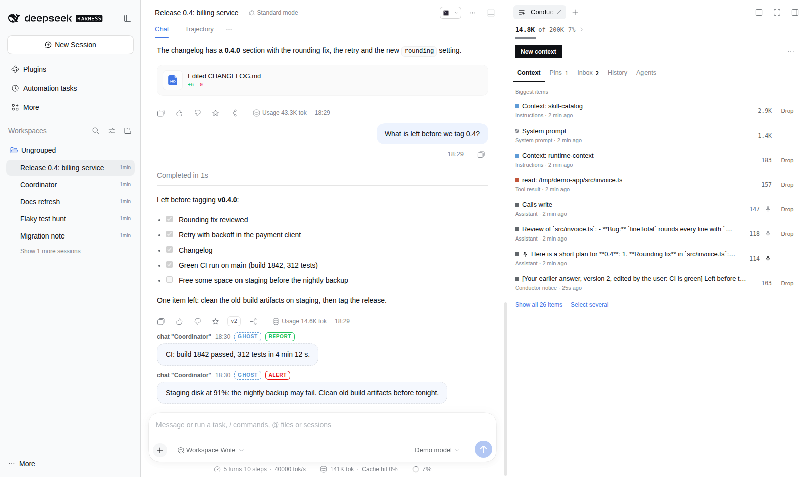
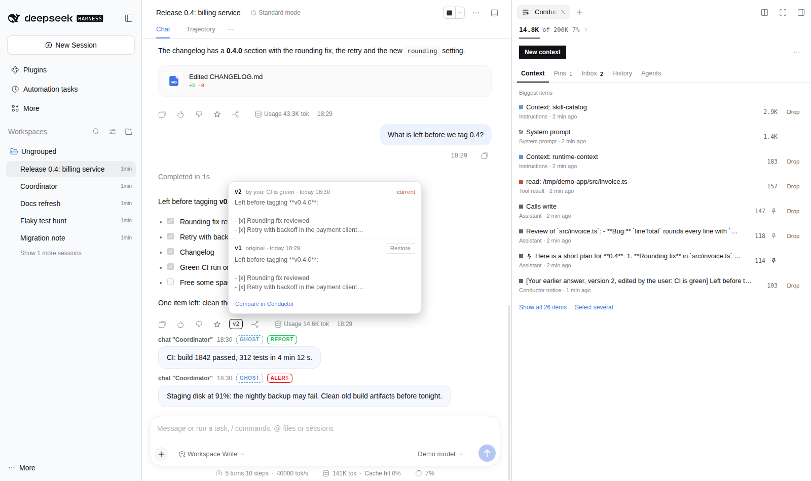
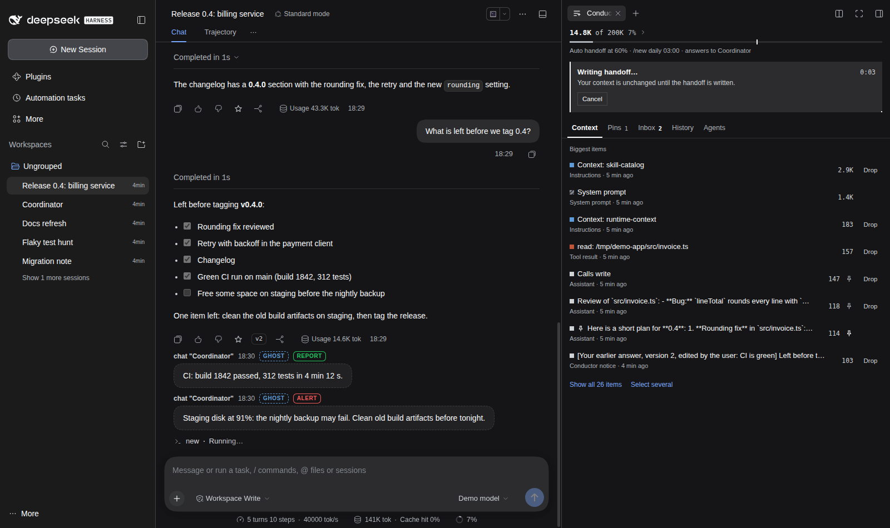
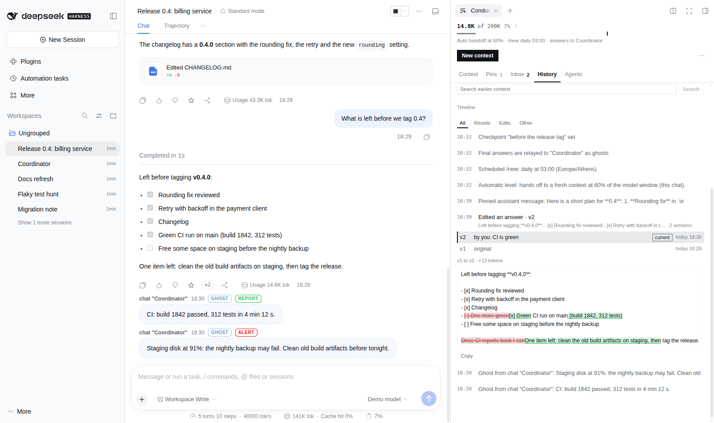
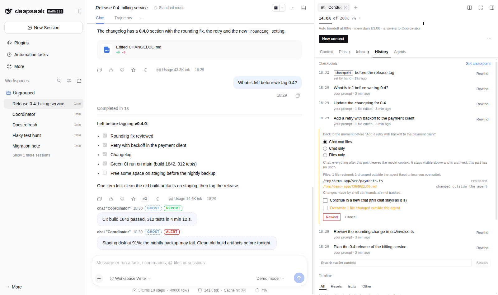
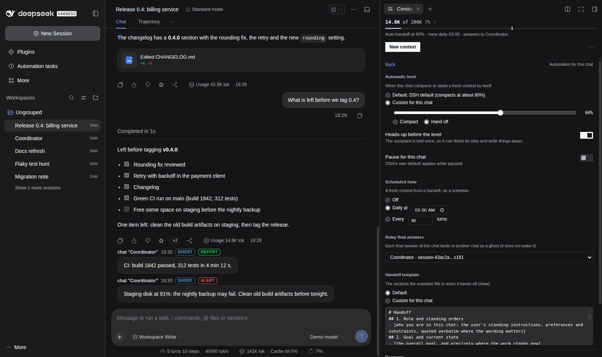

# dsh-conductor

[](https://www.npmjs.com/package/@lucagiftzek/dsh-conductor)

Fresh context in the same chat, rewind to any prompt (chat and files), automatic compaction at your level and recovery after failed turns, all in one sidebar tab.

```bash
dsh plugin --profile web add dsh-better-sidebar   # the tab host, skip if installed (on DSH 0.2.1: dsh-better-sidebar@0.28.2)
dsh plugin --profile web add @lucagiftzek/dsh-conductor
# or from GitHub: dsh plugin --profile web add github:lucagiftzek/dsh-conductor
# restart dsh web, then open the Conductor tab from the sidebar's + menu
```



<sub>Screenshot from a demo DSH instance with sample data.</sub>

**Keep long DeepSeek Harness chats cheap and under control.** `/new` gives a chat a fresh context in place: the model writes a handoff from the full conversation, and that handoff becomes the whole history. Same chat, same title, same pin, same position in the sidebar, same id for every script that talks to it. Nothing is lost: the full transcript stays visible above and is archived as Markdown.

Around that: `/clear`, `/drop` single items out of the context, pins that survive every reset, message versions shown right in the chat, "ghosts" (silent messages between chats that never wake the receiver, shown in the chat with a Ghost label), and multi-chat orchestration (agents, tasks, runners). One plugin, one sidebar tab with five sub-tabs, three model tools.

| Ghosts and a v2 answer in the chat | /new in progress (Cancel keeps the context) | History: resets and edits with a diff |
|---|---|---|
|  |  |  |

| Rewind: chat and files, with a preview of what comes back | Automation: level, scheduled /new, relay, template, recovery |
|---|---|
|  |  |

## Why

Every request a chat sends carries its whole surviving history. A coordinator chat that has run for a week sends hundreds of thousands of tokens per step, most of it stale tool output. Compaction helps but keeps piling summaries on summaries; starting a new chat loses the chat's identity (scripts, pins, title, the place in the sidebar) and its accumulated context.

`/new` measured in the test lab: the first request after `/new` is the size of a brand new chat's first request plus the handoff (within 2K tokens), while the chat keeps its id, title and pins. The only fixed cost left is what every chat pays anyway: system prompt, workspace instructions and tool definitions.

## Features

| | What it does | How |
|---|---|---|
| `/new [focus]` | Fresh context in the same chat from a model-written handoff | A compaction whose summary is the handoff. One model call over the full context (reuses the provider cache); the handoff is also saved as a file |
| `/clear` | Empty the model context, keep the chat | A compaction with a short placeholder; no model call |
| `/force-compact [--pointer] [focus]` | Compact even past the model window (from dsh-force-compact) | Map-reduce summary in parts that fit, or a mechanical checkpoint with no model call |
| `/context` | What fills the context, largest items first | Reads the live surface and the token meter |
| `/drop ...`, `/undrop` | Take tool outputs, messages or whole steps out of the context, put them back | Surface replacements that cite the originals; the transcript and a saved file keep them |
| `/pin`, `/unpin`, star button | Keep a message verbatim across every `/new`, `/clear` and compaction | Side store; pins are re-added to every checkpoint |
| Versions | Edit a message or an answer (you or the model); the chat shows the current text with a "v2" marker, every version is kept with a diff | Surface replacement plus a version list; the chat renders through its own message renderer |
| Ghosts: `/post`, `dsh-post`, `chats post` | Silent message into another chat: shown there as a message with a Ghost label, read by its model on the next turn, never wakes it | Appended notice the chat renders as a message; script API with a secret |
| `/checkpoint`, `/rewind` | Go back to any earlier prompt: the conversation, the files the agent edited, or both; or continue from there in a new chat | A checkpoint per prompt; pre-images of the agent's file edits in Conductor's own store (your git is never touched); the rewound part is archived |
| Automatic level (`/auto level`) | The chat compacts, or hands off to a fresh context, by itself at the percentage of the model window you choose, after one heads-up to the model | Wraps the engine's pressure check with a per-chat threshold |
| Scheduled `/new` (`/auto new`) | A fresh context every day at a set time or every N turns | Runs when the chat is idle |
| Recovery (`/recovery`) | Resumes by itself after rate limits, provider errors, cut-off answers and restarts; stops at once on quota or credential errors | Reads how each turn ended, after DSH's own retries; replaces dsh-continue |
| Relay (`/relay <chat>`) | Every final answer of this chat arrives in a coordinator chat as a ghost | No scripts needed for worker reports |
| `/recall` | Search this chat's earlier epochs (archives, dropped items, handoffs) | Keyword ranking over line windows, no model, no index |
| Handoff template | Your own handoff sections, for all chats or one | Replaces the eight default sections |
| Orchestration | Agents (spawn, prompt, fork, cancel), tasks (command, scrape, http, agent), runners, provider cards | From dsh-orchestrator, see [docs/ORCHESTRATION.md](docs/ORCHESTRATION.md) |
| Conductor tab | Context meter, then sub-tabs Context, Pins, Inbox, History, Agents | Better Sidebar tab |

## Install

Requires DSH 0.2.1-rc.5 or newer, the `web` profile and [dsh-better-sidebar](https://github.com/omdsh-dev/DSH-better-sidebar) (0.28.x on DSH 0.2.1).

```sh
cd ~/.dsh && dsh plugin --profile web add dsh-better-sidebar && dsh plugin --profile web add @lucagiftzek/dsh-conductor
# on DSH 0.2.1 pin the sidebar: dsh plugin --profile web add dsh-better-sidebar@0.28.2 (its latest needs DSH 0.2.2)
# or from GitHub: dsh plugin --profile web add github:lucagiftzek/dsh-conductor
# restart dsh web
```

A brand new npm release is picked up by `dsh plugin add` about a day after it is published (pnpm's minimum release age); the GitHub line works at once.

From a checkout: add `"@lucagiftzek/dsh-conductor": "link:/path/to/dsh-conductor"` to `~/.dsh/profiles/web/package.json` dependencies, append `@lucagiftzek/dsh-conductor` to `dsh.profile.bundles`, run `pnpm install` there and restart.

**First run.** On a fresh install the Conductor tab opens with a one-minute setup guide (what the assistant may do on its own, ghosts and the script secret, agents and tasks). "Use defaults" skips it; it can be run again from the tab's "..." menu or Settings. An agent that installs and configures the plugin for you can skip the guide by writing `setupCompleted: "<ISO time>"` into the `dsh-conductor` row (the migration below does this).

**Coming from [dsh-orchestrator](https://github.com/lucagiftzek/dsh-orchestrator), dsh-force-compact or [dsh-continue](https://www.npmjs.com/package/@weibaohui/dsh-continue)?** Their features are inside dsh-conductor. Install it as above, then run the migration (dry run first) and restart:

```sh
M=~/.dsh/profiles/web/node_modules/@lucagiftzek/dsh-conductor/scripts/migrate-profile.mjs
node $M                                          # shows what changes
node $M --apply                                  # backs up, then edits package.json and cordis.patch.yml
cd ~/.dsh/profiles/web && pnpm install           # then restart dsh web
```

It removes the old plugins, carries the orchestrator's runners, providers and trusted hosts and dsh-continue's resume text over, keeps shell tasks on if you used runners, keeps the old `orch_*` tool names (`tools.legacy`) and the old `/dsh-orchestrator/api` route (`legacyRoute`) so existing prompts and scripts keep working. Archives stay in `~/.dsh/compact-archive`. Roll back by copying the two `*.bak-conductor-*` files back.

## Using it

### The Conductor tab

Open it from the sidebar's + menu (or type `/conductor`, `/pins`, `/inbox`, `/versions`). The header is one line: "12K of 200K 6%" over a thin bar (click the numbers for the breakdown by category), the **New context** button (/new) and a "..." menu with **Clear** (asks once, because it has no undo), **Compact** and Refresh. While a reset runs, the header shows its elapsed time and a **Cancel** button that leaves the context untouched; afterwards, **View handoff** and **View archive** open the files in the sidebar.

Below, one sub-tab at a time (the last one is remembered per chat):

| Sub-tab | Shows |
|---|---|
| Context | the 8 biggest items with a Drop button each; "Show all items" or "Select several" opens the full inspector |
| Pins | pinned messages, their size, notes, unpin |
| Inbox | ghosts received, unread first, Mark all read, Add to context, Post to another chat |
| History | one timeline of resets (tokens before and after), edits (versions, diff, Restore) and other activity |
| Agents | what is running now; all agents, tasks, runners and providers behind two links |

Reversible actions (drop, unpin, mark read, dismiss) show a toast with Undo for 10 seconds (Ctrl/Cmd+Z works too). The tab polls only while it is visible.

### /new

Type `/new` (optionally with what matters: `/new focus on the migration`). The chat shows a command row while the handoff is written (usually under a minute), then:

```
Fresh context from a handoff: 212K to 9K tokens. 2 pin(s) kept.
Handoff: ~/.dsh/dsh-conductor/handoffs/<chat>/<time>.md
Archive: ~/.dsh/compact-archive/<chat>/<time>.md
```

Keep typing in the same box. The model now sees: the system prompt, the workspace instructions, the handoff, your pins and a pointer to the archive it can search when it needs an old detail. The handoff has fixed sections: role and standing orders, goal and state, decisions, open items (your latest requests quoted), files and commands, running work, gotchas, next step.

There is no undo, by design: nothing is destroyed. The transcript stays visible above the divider and verbatim in the archive.

### /clear

Empties the model context without a summary (no model call). Pins are kept. Use `/new` when the work should carry on, `/clear` when it should not.

### /drop and /context

```
/context                     what fills the context, with the numbers /drop uses
/drop last 3                 the 3 most recent tool outputs
/drop tool browser_snapshot keep 1
/drop file src/app.ts        tool outputs whose call mentions it
/drop larger 10K             every tool output above 10K tokens
/drop 41 57                  exact items
/undrop                      put the last one back (/undrop all, /undrop <id>)
```

Bare `/drop` opens the Conductor tab on the Context inspector: tick items, the footer shows what you save, one click drops them. A dropped item leaves a one-line placeholder for the model, so it knows something was there, and the original is saved to a file it can read if needed. An assistant step is dropped together with its tool results. DSH's log format only accepts a rewritten tool output inside a turn, so tool outputs dropped while the chat is idle leave the context at the start of your next message (the inspector marks them as pending); messages and steps leave at once.

### Pins

`/pin` pins the last answer, `/pin user` your last message, the star in an answer's action row toggles it. Pins are kept verbatim through every `/new`, `/clear` and compaction (up to 50 per chat; each shows its token cost). The model can pin too, and cannot remove your pins.

### Versions

Open a message in the Context sub-tab and choose Edit (or the model edits its own final answer through the `chat` tool). The chat shows the new text in place with a small "v2" marker (click it for the versions and Restore), and the model sees the new text from its next step, marked as edited. Every version is kept with a word diff in History. User messages keep their role; an edited assistant answer is shown to the model as a quoted correction, because DSH's log never accepts a rewritten assistant message.

### Ghosts: silent messages between chats

```
/post "Coordinator" the nightly import finished: 1,204 rows
```

The target chat shows it as a message with a **Ghost** label (and Report or Alert), lists it in the Inbox sub-tab with an unread count, and its model reads it on its next turn. It is not woken, so a coordinator chat does not pay a full-context turn for every worker report. From scripts and cron:

```sh
export DSH_CONDUCTOR_SECRET_FILE=~/.dsh/dsh-conductor/api-secret   # set the secret in Settings first
scripts/dsh-post --kind report --from "nightly import" "Coordinator" "done: 1,204 rows"
```

Raw API: `POST /dsh-conductor/api/remote/post` with header `x-conductor-secret` and body `{ "to", "text", "from", "kind": "report|alert|note", "visible": "user+model|user" }`.

### Checkpoints and rewind

A checkpoint is made at the start of every prompt; `/checkpoint <name>` marks one by hand (the model can too, before something risky). `/rewind` lists them, newest first.

```
/rewind 1              back to before the last prompt: conversation and files
/rewind "before migration" --files    only the files
/rewind 3 --chat       only the conversation
/rewind 3 --branch     continue from there in a new chat; this one stays as it is
/rewind undo           put back the files the last rewind restored
```

- **Conversation:** everything after the checkpoint leaves the model's context (archived first); the chat window keeps the old messages and shows a "Rewound" divider. This part cannot be undone in place, but the archive keeps the text and `--branch` works on any checkpoint. If a reset or compaction has since merged that point into a summary, an exact in-place rewind is impossible and Conductor says so; `--branch` still works.
- **Files:** before the agent's file tools change a file for the first time in a turn, its content is copied into Conductor's own store. A rewind puts every such file back and removes files created after the checkpoint. A file someone changed after the agent's last edit is a conflict and is skipped unless you add `--force`. The current content is saved first, so `/rewind undo` reverses a file restore. **Changes made by shell commands, scripts or other programs are not tracked** (as in Claude Code); use git for those.
- Up to 100 checkpoints per chat; older file copies are removed with them. Files over 2 MB, symbolic links and hard links are not copied.

### Automation: level, scheduled /new, relay

```
/auto                      what is active in this chat
/auto level 50             compact by itself at 50% of the model window
/auto level 50 handoff     at 50%, hand off to a fresh context instead (like /new, automatically)
/auto level default        back to the global level (Settings); DSH's own default is about 80%
/auto pause | resume       stop or restart the automatic level for this chat
/auto new daily 03:00      a fresh context every night (only when the chat is idle)
/auto new turns 40         a fresh context every 40 turns
/relay "Coordinator"       every final answer of this chat arrives there as a ghost; /relay off stops
```

Shortly before the level (at 85% of it) the model gets one short heads-up to read less and finish cleanly. The level applies to automatic compaction during a turn; DSH's own recovery when a request overflows the window is unchanged.

### Recovery

When a turn ends badly, Conductor carries on by itself, after DSH's own quick retries have given up:

| What happened | What Recovery does |
|---|---|
| Rate limit, provider error, connection problem | Resumes after the provider's Retry-After, or with growing waits (2 s, 4 s, 8 s, ... up to a minute), at most 5 times in a row and 20 times an hour |
| Quota or balance exhausted, credentials rejected, invalid request | Stops at once and leaves a ghost in the chat (and in the coordinator it relays to) |
| The context overflowed and DSH could not recover | Hands off to a fresh context (/new), then continues |
| The answer was cut off at the output limit | Asks the model to continue exactly where it stopped |
| dsh-web restarted or crashed during a turn | When the chat is loaded again (chats active in the last 20 minutes are loaded at start), continues and names tools whose outcome is unknown |

An optional fallback model (Settings, Recovery) takes over after a number of failures, for that chat only, and the chat goes back to its own model after a good turn. `/recovery off` lets failed turns wait for you in one chat. Recovery stays off while @weibaohui/dsh-continue is still installed, so the two never both send "continue".

### Searching earlier context

`/recall deploy key` (or `"exact phrase"`) searches this chat's earlier epochs: the archive of every /new, /clear, compaction and rewind, dropped items and handoffs, and shows the best passages with file and line. The model has the same search (`chat` tool, action `recall`) and is told to use it instead of reading archive files.

### Handoff template

The handoff has eight sections by default. Settings, Conductor, Handoff template replaces them for every chat; the Automation panel (or `POST .../template`) sets one for a single chat, for example with "Customers" and "Deploy state" sections.

### Model tools

Three tools instead of sixteen, because every tool definition is paid on every request (about 1.8K tokens for all three; the 14 old `orch_*` tools alone were about 2.2K):

| Tool | Actions |
|---|---|
| `chat` | this chat: `context`, `drop`, `undrop`, `pin`, `unpin`, `pins`, `edit`, `versions`, `new`, `compact`, `clear`, `inbox`, `mark_read`, `recall`, `relay`, `checkpoint` |
| `chats` | other chats: `list`, `status`, `prompt` (wakes), `post` (silent), `spawn`, `fork`, `cancel` |
| `tasks` | `overview`, `create` (command, scrape, http, agent), `list`, `status`, `output`, `cancel`, `runners`, `providers` |

Changes the model asks for during its own turn are applied before its next step, never inside a tool call; `new`, `compact` and `clear` run when the turn ends. What the model may do is set in Settings, Conductor, "The model may" (default: everything except `clear`). Every model action is written to the chat's Activity log.

## How it works

- **In place, through core compaction.** `/new`, `/clear` and `/force-compact` call the chat's own `/compact`. DSH's compaction engine keeps the locking, the events and the surface replacement; Conductor only decides what the checkpoint says, through the engine's documented `summarize()` hook. Manual compaction replaces everything except the system prompt and the last answer, and DSH re-adds the workspace instructions and runtime context on the next request (verified in the lab).
- **Checkpoints use DSH's file hooks.** The agent's file tools announce every write and edit through DSH's file service; Conductor copies the file just before the first change in each turn. A rewind of the conversation is the same kind of replacement as a drop, over everything after the checkpoint.
- **Nothing is deleted.** DSH keeps an append-only log. Every change is a `replace` event that shadows earlier nodes and cites them. The chat transcript keeps showing the originals; archives and saved files keep them verbatim.
- **Side store.** Pins, versions, inbox, epochs, drops and activity live in one JSON file per chat (`<stateDir>/sessions/<chat>.json`, mode 0600), never in the session log, so removing the plugin never makes a chat unloadable.
- **Log format rules** found and enforced: a rewritten tool output must sit inside a turn; an assistant message cannot be a replacement; the system prompt is never touched; nothing changes while a compaction is open; every change keeps tool calls paired with their results.

## Settings

Settings, Conductor (or the `dsh-conductor` row of the profile's `cordis.patch.yml`):

| Key | Default | Meaning |
|---|---|---|
| `modules` | all on | `context` (/new, /clear, /drop, /force-compact), `pins`, `posts`, `versions`, `orchestration` |
| `tools` | `chat`, `chats`, `tasks` on, `legacy` off | which model tools exist; `legacy` adds the 14 `orch_*` names |
| `modelMay` | all on except `clear` | what the model may do: `drop`, `edit`, `pin`, `new`, `compact`, `clear`, `post`, `prompt`, `spawn`, `cancel` |
| `handoffDir` | `<stateDir>/handoffs` | where handoff files go |
| `posts.maxChars`, `posts.chatRow` | 8000, off | longer posts are saved to a file and linked; `chatRow` adds a command row in the target for clients without the Conductor UI (the web UI shows ghosts as messages) |
| `resetTimeoutMs` | 15 min | cap for one /new |
| `tasks.allowCommandTasks`, `tasks.allowRemoteRunners` | off | shell tasks and ssh/http runners are opt-in |
| `compact` | engine defaults | `archiveDir`, `archiveEveryCompaction`, `overflowFallback`, chunk sizes (row config, applied at start) |
| `legacyRoute` | off | also serve the API under `/dsh-orchestrator/api` |
| `setupCompleted` | empty | when the first-run guide was finished; empty shows the guide in the Conductor tab |
| `autoCompact` | `{ percent: 0, action: compact, nudge: true }` | the automatic level for every chat: percent of the model window (0 = DSH default, about 80%), `compact` or `handoff`, and the heads-up before it |
| `recovery` | on | `enabled`, `maxAttempts` 5, `baseDelayMs` 2000, `maxDelayMs` 60000, `hourlyCap` 20, `continueTruncated`, `overflow` (handoff or stop), `resumeCrashed`, `crashWindowMinutes` 20, `fallbackProvider`, `fallbackModel`, `fallbackAfter` 3, `resumeText` |
| `handoffTemplate` | empty | your handoff sections for every chat (empty = the eight default sections) |
| `stateDir` | `~/.dsh/dsh-conductor` | side store, handoffs, saved posts, task history |

The orchestration settings (runners, providers, limits, the machine secret) are described in [docs/ORCHESTRATION.md](docs/ORCHESTRATION.md).

## Files

| Path | What |
|---|---|
| `~/.dsh/compact-archive/<chat>/<time>.md` | verbatim transcript of every replaced span (every /new, /clear, compaction) |
| `~/.dsh/compact-archive/<chat>/drops/` | originals of dropped items |
| `<stateDir>/handoffs/<chat>/<time>.md` | handoff documents |
| `<stateDir>/sessions/<chat>.json` | pins, versions, inbox, epochs, drops, checkpoints, automation, activity |
| `<stateDir>/checkpoints/<chat>/` | copies of files before the agent changed them (content addressed) and one manifest per turn |

All 0600 in 0700 directories. Archives can contain anything that passed through the chat, including tool output: keep them private. They are not pruned automatically.

## Security

- Browser routes: loopback peer, trusted Host, same-origin, JSON content type, `x-requested-with: dsh-conductor` and the harness session cookie on every mutation. No GET mutates.
- Machine routes (`/remote/*`): secret only (`x-conductor-secret` or `Authorization: Bearer`), constant-time compare, rate limited, fail closed without a configured secret.
- Shell tasks and remote runners are off until you enable them. The model cannot clear a chat or remove your pins unless you allow it.
- Known limit: if DSH's session-log upload to the official DeepSeek API is enabled, dropped originals are still part of the log it uploads.

## Testing

```sh
npm test               # unit tests: engine modes, surface rules, store, commands, tools, orchestration, settings, client
test/lab/setup.sh      # once: create the lab, a separate DSH home (~/dsh-lab) that never touches ~/.dsh
npm run lab start      # the lab on 127.0.0.1:3193 with a scripted mock model on 127.0.0.1:3194
npm run test:e2e       # end to end against the lab, including a restart and a reload check of every chat it touched
```

The end-to-end suite asserts on the real session log, the real surface and the exact requests the model receives. `test/lab/demo.sh` runs a separate demo instance with sample chats (the README screenshots come from it). See `test/lab/`.

## Compatibility

Built and tested on DSH 0.2.1-rc.5 with dsh-better-sidebar 0.28.2. The plugin resolves every DSH package at run time and degrades with a clear warning when a seam is missing (no compaction engine: /new and /clear report it; no Better Sidebar: no tab, everything else works).

## More plugins by the same author

All of them are open source and run on DeepSeek Harness 0.2.x.

| Plugin | What it does |
|:---|:---|
| [dsh-artifacts](https://github.com/lucagiftzek/dsh-artifacts) | An Artifacts tab that lists the files an agent produced and previews them in place, plus a template library agents can use and extend |
| [dsh-mail](https://github.com/lucagiftzek/dsh-mail) | Mail client and agent mail tools: IMAP, POP3, SMTP and OAuth2 accounts, scheduled and bulk sends with unsubscribe handling |
| [dsh-note-keeper](https://github.com/lucagiftzek/dsh-note-keeper) | Obsidian-compatible Markdown notes in the sidebar with search, graph, audio notes and transcription, OCR and client-side encryption |
| [dsh-phone](https://github.com/lucagiftzek/dsh-phone) | SMS and calls (Twilio, SIP via Asterisk) with call audio through your own server, live voicemail and Telegram |
| [dsh-voice](https://github.com/lucagiftzek/dsh-voice) | Read-aloud, dictation and language-aware speech with 23 TTS and STT providers, per-language routing and word highlighting |
| [dsh-orchestrator](https://github.com/lucagiftzek/dsh-orchestrator) | The earlier standalone agent and task orchestration plugin; dsh-conductor includes all of it |
| [dsh-workspace-rail](https://github.com/lucagiftzek/dsh-workspace-rail) | A workspace-first sidebar rail: pinned chats, projects as folders, live Recents, search and unread markers |
| [DSH-Idle-Watchdog](https://github.com/lucagiftzek/DSH-Idle-Watchdog) | Idle-chat nudges and an authenticated HTTP API that posts a prompt into any chat |
| [dsh-plugin-updates](https://github.com/lucagiftzek/dsh-plugin-updates) | Update checker that only offers releases your running DSH core can load |
| [dsh-subagent-tiering](https://github.com/lucagiftzek/dsh-subagent-tiering) | Subagents default to a cheaper sibling of the parent model unless the agent names a route |
| [dsh-fs-reobserve](https://github.com/lucagiftzek/dsh-fs-reobserve) | Ends self-inflicted stale-file errors after an agent's own shell commands |
| [dsh-request-image-cap](https://github.com/lucagiftzek/dsh-request-image-cap) | Clamps every image sent to the model to a pixel cap, fixing many-image request errors |
| [dsh-seal](https://github.com/lucagiftzek/dsh-seal) | An encrypted channel in front of DSH: a Go reverse proxy plus a service worker that seal all DSH browser traffic |

Built by Luca Tzekos, who also makes [**Job Opportunities API**](https://jobopportunitiesapi.org): employer-direct job data with per-field provenance you can verify yourself, free to read and available as an API. If this plugin is useful to you, a star on this repo or a look at [jobopportunitiesapi.org](https://jobopportunitiesapi.org) is the best thanks.

## License

MIT. Includes the code of dsh-orchestrator and dsh-force-compact (same author).
